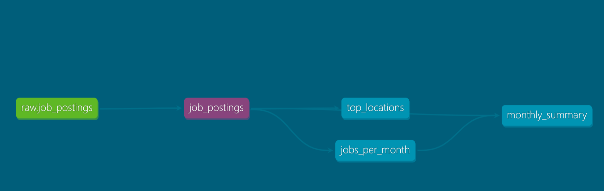

# Automated Job Postings Pipeline (v1) - dbt + DuckDB

[](https://github.com/najran77/dbt-duckdb-pipeline/actions/workflows/dbt_build.yml)
[](https://najran77.github.io/dbt-duckdb-pipeline/#!/overview/analytics)


A public dbt + DuckDB pipeline over ~692k real job postings, rebuilt and republished automatically on every push.

- Models the raw postings into tested, documented insight marts
- Publishes the finished warehouse — open to anyone, no credentials
- Runs itself on GitHub Actions: every push and every Monday

| What I Built | How I Implemented | Where to Look |
| --- | --- | --- |
| **dbt pipeline** | source → cleaned model → insight marts | [`analytics/models/`](https://github.com/najran77/dbt-duckdb-pipeline/tree/master/analytics/models) |
| **Data tests** | `unique` / `not_null` on key columns | [`schema.yml`](https://github.com/najran77/dbt-duckdb-pipeline/blob/master/analytics/models/schema.yml) |
| **Dbt docs** | lineage, descriptions, column tests | [Live docs site](https://najran77.github.io/dbt-duckdb-pipeline/#!/overview/analytics) |
| **Public CI** | build + test + publish on every push | [Actions workflow](https://github.com/najran77/dbt-duckdb-pipeline/blob/master/.github/workflows/dbt_build.yml) |
| **Environments** | local `dev` vs CI `prod` targets | [`ci/profiles.yml`](https://github.com/najran77/dbt-duckdb-pipeline/blob/master/ci/profiles.yml) |
| **Published warehouse** | one `ATTACH`, queryable by anyone | [Query it](#-query-the-published-warehouse) |

---

## 🔧 The dbt Pipeline

One declared source flows through dbt into three insight marts — with tests gating every build. The dependency graph, chained entirely with `ref()`:



No hardcoded table names anywhere — dbt resolves the build order (and what can run in parallel) from the graph itself.

| dbt Feature | How I Used It |
| --- | --- |
| **Declared sources** (no hardcoded paths in SQL) | [`sources.yml`](https://github.com/najran77/dbt-duckdb-pipeline/blob/master/analytics/models/sources.yml) + `source('raw', 'job_postings')`, resolved via `external_location` straight to the parquet files |
| **Model dependencies** | `ref()` everywhere downstream; dbt resolves order and parallelism |
| **Materializations** | project default `table` ([`dbt_project.yml`](https://github.com/najran77/dbt-duckdb-pipeline/blob/master/analytics/dbt_project.yml)); `job_postings` overrides to `view`, since it's a thin pass-through over the source |
| **Data tests** | `unique` / `not_null` on key columns in [`schema.yml`](https://github.com/najran77/dbt-duckdb-pipeline/blob/master/analytics/models/schema.yml) |
| **Persisted docs** | `persist_docs` on every model — descriptions land as real `COMMENT ON` in DuckDB, not just dbt's own docs site |
| **Environments** | local `dev` vs CI `prod` targets ([`ci/profiles.yml`](https://github.com/najran77/dbt-duckdb-pipeline/blob/master/ci/profiles.yml)) |

`dbt build` compiles SQL, materializes models, and fails the run if any test fails — same command locally and in CI.

---

## 🚀 Production

GitHub Actions runs the whole pipeline — no laptop required: [`.github/workflows/dbt_build.yml`](https://github.com/najran77/dbt-duckdb-pipeline/blob/master/.github/workflows/dbt_build.yml)

| Trigger | What happens |
| --- | --- |
| Push to `master` | Full rebuild |
| Weekly (Monday) | Scheduled rebuild — pipeline stays fresh |
| Manual (`workflow_dispatch`) | Run button in the Actions UI |

On each run, Actions:

1. Installs deps with `uv`
2. Downloads raw parquet
3. Runs `dbt build` with the committed CI profile (`prod`)
4. Publishes `prod.duckdb` as a GitHub Release asset

The badge at the top of this README links to the latest runs.

---

## 🦆 Query the published warehouse

No clone required. [Install DuckDB](https://duckdb.org/docs/installation/), then from a `duckdb` session:

```sql
INSTALL httpfs;
LOAD httpfs;

ATTACH 'https://github.com/najran77/dbt-duckdb-pipeline/releases/download/warehouse/prod.duckdb' AS jobs;
USE jobs;
SHOW TABLES;

SELECT * FROM top_locations;
SELECT * FROM monthly_summary;
```

> The database lives at the release asset URL above, rebuilt from scratch on every push and every Monday.

---

## 📖 Docs

Docs are generated with `dbt docs generate` and published to GitHub Pages:

**→ [najran77.github.io/dbt-duckdb-pipeline](https://najran77.github.io/dbt-duckdb-pipeline/#!/overview/analytics)**

The site shows:

- The full **lineage graph** (source → models → marts)
- **Model and column descriptions** from the YAML
- Which columns carry **tests**

---

## 💻 Run it yourself

```bash
uv sync
uv run python scripts/download_data.py
cd analytics && uv run dbt build
```

Optional docs locally:

```bash
uv run dbt docs generate
uv run dbt docs serve
```

---

## 📁 Project layout

```text
.
├── .github/workflows/dbt_build.yml   # public CI: build, test, publish
├── ci/profiles.yml                   # prod DuckDB target for Actions
├── data/                             # raw + warehouses (gitignored; CI regenerates)
├── docs/                             # dbt docs site (GitHub Pages)
├── scripts/download_data.py          # fetch raw parquet before build
└── analytics/
    ├── dbt_project.yml
    └── models/                       # source, models, schema.yml
```
